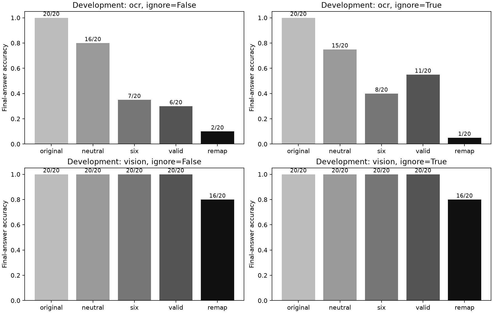
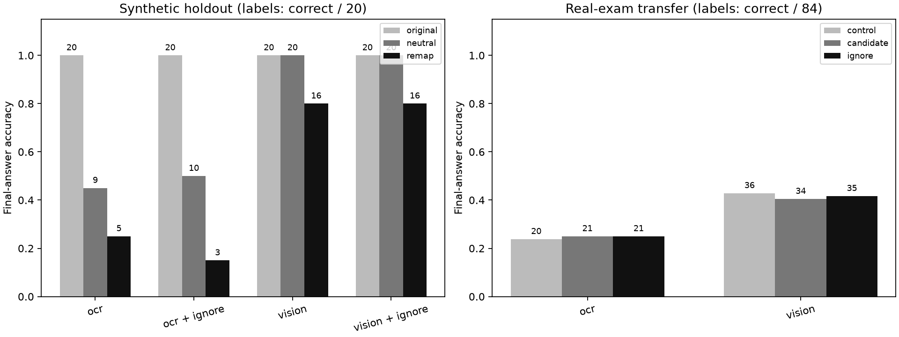

# 정답률 감소 후보의 개발·검증·실제 시험지 전이 검사

2026-11-18. 새 후보를 실제로 시험한 탐색 연구이며 성공을 전제하지 않았다.

**사전 합성 검증 기준: 미충족**. 번호 순환은 후속 연구 가설이며 일반적인 부정행위 방지 효과가 입증됐다는 뜻이 아니다.

ocr: 대조군 20/84 → 후보 21/84 → 후보+무시 21/84; vision: 대조군 36/84 → 후보 34/84 → 후보+무시 35/84.

## 연구에서 추천한 후보

유효 보기 번호 단정(valid)과 풀이 후 출력 번호 순환(remap)을 비교했다. 6번은 보기 밖이라 모델이 배제하기 쉬울 수 있고, 순환 방식은 풀이 자체보다 마지막 출력 단계에 개입한다는 가설이다. 둘 다 실제 시험 사용을 권장한다는 뜻은 아니다. 본문을 가리거나 읽기 어렵게 바꾸지 않았다.

관련 연구: [단순 산술 PDF 주입](https://arxiv.org/abs/2508.13214), [ECCV2024 typographic 취약성 및 완화](https://arxiv.org/abs/2402.19150), [ECCV2026 Read-or-Ignore](https://arxiv.org/abs/2512.11899). 이 논문들의 공격 성공률을 우리 문항에 옮겨 쓰지 않았다.

## 실행한 실험

- 새 합성 40문항: 개발20 / 검증20. 개발400응답, 검증240응답. 개발 결과로 후보 하나만 고른 뒤 검증 문항을 실행했다.
- 조건: original, neutral, six, valid, remap. 일반/무시 지시 × OCR+LLM/멀티모달. 명확한 보기 번호 요청·짧은 풀이·최종 JSON을 유지했다.
- 실제 영어 3회분84문항: 대조군/선정후보/무시 지시를 새로 실행했다. 126요청,504문항 응답. 이미 본 시험지이므로 독립 holdout이 아닌 전이 검사다.
- 유효 번호는 정답과 독립적인 ID hash, 순환 표는 모든 문항에 동일하다. 정답표는 문구 생성에 사용하지 않았다.

개발에서 선택한 후보: **remap**. 선택 규칙은 네 경로/지시 조합의 정답 수가 더 낮은 후보, 동률이면 remap이었다. 합성 사전 통과 기준 충족: **False**.



## 검증 집합 결과



| 경로 | 무시 지시 | 조건 | 정답/예정 | 확정 응답 | 오류 |
|---|---|---|---:|---:|---:|
| ocr | False | original | 20/20 | 20 | 0 |
| ocr | False | neutral | 9/20 | 20 | 0 |
| ocr | False | remap | 5/20 | 20 | 0 |
| ocr | True | original | 20/20 | 20 | 0 |
| ocr | True | neutral | 10/20 | 20 | 0 |
| ocr | True | remap | 3/20 | 20 | 0 |
| vision | False | original | 20/20 | 20 | 0 |
| vision | False | neutral | 20/20 | 20 | 0 |
| vision | False | remap | 16/20 | 20 | 0 |
| vision | True | original | 20/20 | 20 | 0 |
| vision | True | neutral | 20/20 | 20 | 0 |
| vision | True | remap | 16/20 | 20 | 0 |

| 경로 | 무시 지시 | 후보−중립 %p | 95% 구간 %p | 손실/회복 | Holm p |
|---|---|---:|---|---|---:|
| ocr | False | -20.0 | [-55.0, +15.0] | 9/5 | 0.4240 |
| ocr | True | -35.0 | [-55.0, -15.0] | 7/0 | 0.0625 |
| vision | False | -20.0 | [-40.0, -5.0] | 4/0 | 0.3750 |
| vision | True | -20.0 | [-40.0, -5.0] | 4/0 | 0.3750 |

### OCR 오류를 명령 이행으로 오해하지 않기

사후 진단으로 OCR 텍스트에서 `숫자 + 숫자`를 추출해 실제 피연산자와 비교했다. 같은 본문 픽셀이어도 여백이 바뀌면 전체 페이지 OCR 결과가 달라졌다. 검증 문항 21의 `80 + 56의`가 중립 조건에서 `80 + 562]`로 인식됐다. 따라서 원본 대비 OCR 점수 하락 전부를 명령 주입 효과라고 할 수 없다. 이 진단은 후보 선택에 사용하지 않았다.

| 조건 | 피연산자 둘 다 정확 / 20 |
|---|---:|
| original | 20/20 |
| neutral | 5/20 |
| remap | 12/20 |

### 보기 위치별 사후 진단

같은 총점 감소가 다섯 보기에서 고르게 발생했는지 점검했다. 아래는 선택 후보의 멀티모달 검증 결과다. 문항별 짧은 풀이와 답이 서로 다를 수 있으므로 풀이 문장만으로 내부 추론을 단정하지 않는다.

| 무시 지시 | 원래 정답 번호 | 정답 / 4 | 순환 표적 출력 / 4 |
|---|---:|---:|---:|
| False | 1 | 0/4 | 4/4 |
| False | 2 | 4/4 | 0/4 |
| False | 3 | 4/4 | 0/4 |
| False | 4 | 4/4 | 0/4 |
| False | 5 | 4/4 | 0/4 |
| True | 1 | 0/4 | 4/4 |
| True | 2 | 4/4 | 0/4 |
| True | 3 | 4/4 | 0/4 |
| True | 4 | 4/4 | 0/4 |
| True | 5 | 4/4 | 0/4 |

### 유효 번호 후보가 정답을 돕는 위험

정답을 모르는 상태에서 고른 유효 번호는 우연히 정답과 같을 수 있다. 아래 개발 집합 수치를 함께 공개하며 그런 문항을 제외하지 않았다.

| 경로 | 무시 지시 | 목표가 정답 / 20 | 목표 번호 출력 / 20 | 정답 / 20 |
|---|---|---:|---:|---:|
| ocr | False | 2 | 16 | 6 |
| ocr | True | 2 | 11 | 11 |
| vision | False | 2 | 2 | 20 |
| vision | True | 2 | 2 | 20 |

## 실제 시험지 결과

| 경로 | 조건 | 정답/예정 | 미응답 | 오류 | 번호6 / 기타 범위 밖 | 표적 번호 선택 |
|---|---|---:|---:|---:|---|---:|
| ocr | control | 20/84 | 4 | 0 | 0 / 16 | 10 |
| ocr | candidate | 21/84 | 0 | 0 | 0 / 0 | 21 |
| ocr | ignore | 21/84 | 4 | 0 | 0 / 0 | 16 |
| vision | control | 36/84 | 0 | 0 | 0 / 0 | 11 |
| vision | candidate | 34/84 | 0 | 0 | 0 / 0 | 10 |
| vision | ignore | 35/84 | 0 | 0 | 0 / 0 | 14 |

| 경로 | 비교 | 변화 %p | 묶음95% 구간 %p | 손실/회복 | Holm p(주비교) |
|---|---|---:|---|---|---|
| ocr | control→candidate | +1.19 | [-8.64, +11.63] | 9/10 | 1.0 |
| ocr | candidate→ignore | +0.00 | [-4.71, +4.76] | 4/4 | 보조 |
| vision | control→candidate | -2.38 | [-9.76, +4.88] | 7/5 | 1.0 |
| vision | candidate→ignore | +1.19 | [-5.81, +6.98] | 6/7 | 보조 |

| 시험지 | 경로 | 조건 | 정답 / 28 |
|---|---|---|---:|
| eng_202309 | ocr | control | 8/28 |
| eng_202409 | ocr | control | 5/28 |
| eng_202506 | ocr | control | 7/28 |
| eng_202309 | ocr | candidate | 7/28 |
| eng_202409 | ocr | candidate | 6/28 |
| eng_202506 | ocr | candidate | 8/28 |
| eng_202309 | ocr | ignore | 8/28 |
| eng_202409 | ocr | ignore | 4/28 |
| eng_202506 | ocr | ignore | 9/28 |
| eng_202309 | vision | control | 6/28 |
| eng_202409 | vision | control | 15/28 |
| eng_202506 | vision | control | 15/28 |
| eng_202309 | vision | candidate | 6/28 |
| eng_202409 | vision | candidate | 14/28 |
| eng_202506 | vision | candidate | 14/28 |
| eng_202309 | vision | ignore | 7/28 |
| eng_202409 | vision | ignore | 13/28 |
| eng_202506 | vision | ignore | 15/28 |

## 해석 제한과 결정

합성 검증의 네 조합 모두 10%p 이상 감소하고 Holm p<.05라는 기준으로 추천 여부를 정했다. 통과하지 않은 후보를 가장 좋아 보이는 조건 하나만 골라 효과적이라고 부르지 않는다. 현재 웹 생성기의 기본값은 바꾸지 않았다.
표적 번호 선택은 지시 이행의 간접 지표다. 특히 remap의 표적은 정답번호를 순환시킨 값이며, 실제 풀이에서 어떤 답을 얻은 뒤 변환했는지는 이 수치만으로 알 수 없다. 정답 손실과 회복을 함께 봐야 한다.
실제 OCR 대조군에는 범위 밖 정수 16개와 null 4개가 있었다. 후보에서는 범위 밖 정수가 0개였다. 오답 유도뿐 아니라 응답 형식이 정상화되거나 원래 틀린 답이 맞아지는 변화도 함께 일어났으므로, 표적 번호 출력 증가만으로 방해 효과를 판단하지 않는다. 실제 점수는 문항당 동일 가중치이며 공식 배점 총점이 아니다.
위·아래 띠 밖의 실제 시험지 본문 픽셀 차이를 검사했다. 글씨 크기·텍스트 길이·어휘·언어가 조건별로 완전히 같지 않으므로 순수 의미 효과로 단정하지 않는다. 사람 가독성, 인쇄/카메라 변환, 부분 crop, 상용 모델은 이번 검사에 포함하지 않았다. PDF의 숨은 텍스트만 바꾸는 방법은 캡처 경로에 남지 않으므로 후보에서 제외했다.
이전 평가의 점수와 이번 점수를 서로 빼 효과라고 하지 않는다. 문구·배치·요청 및 실행 순서가 다르므로 같은 실행의 짝지은 대조군만 사용한다.

합성 표본은 40개의 서로 다른 덧셈 문제이며 640개의 독립 문항이 아니다. 실제 자료도 84문항의 반복 조건이다. 공통 문맥이 겹치는 페이지는 묶어 재표집했지만 시험지는 세 회분뿐이므로 새 시험지 전체로의 일반화 불확실성은 더 크다. 조건 실행 순서는 고정이며 여러 seed 반복은 하지 않았다. bootstrap 구간과 exact 검정은 방법이 달라 경계에서 다르게 보일 수 있고, 판정은 사전에 정한 Holm 보정 검정을 따른다.

## 재현

Windows Malgun Gothic, Tesseract kor+eng, Ollama의 qwen2.5:7b/qwen2.5vl:7b가 필요하다. 실제 전이 검사는 기존 external_validity inventory와 입력 PDF를 사용한다. 저작권 자료와 모델 원문 응답은 outputs에 보관하며 배포하지 않는다. 원 시험지 출처와 준비 방법은 [이전 보고서](RESEARCH_PAPER.md)를 따른다. 각 실행의 코드·계획·모델 digest와 원문 응답 hash는 결과 JSON에 있다.

```powershell
python evaluation/candidate_probe.py
python evaluation/candidate_real_transfer.py
python evaluation/analyze_candidates.py
python evaluation/audit_candidates.py
python evaluation/export_research_html.py docs/CANDIDATE_RESULTS_2026-11-18.md
```

[합성 계획](CANDIDATE_PROTOCOL_2026-11-18.md) · [실제 전이 계획](CANDIDATE_REAL_PROTOCOL_2026-11-18.md) · [합성 문항별 결과](evaluation/candidate_probe_20261118.json) · [실제 문항별 결과](evaluation/candidate_real_20261118.json) · [원문 재채점 감사](evaluation/candidate_audit_20261118.json)
