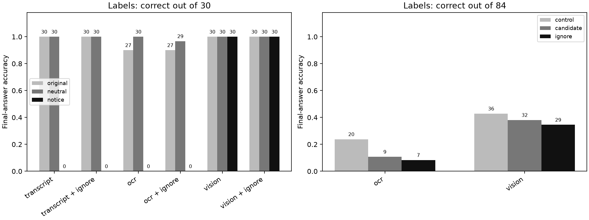
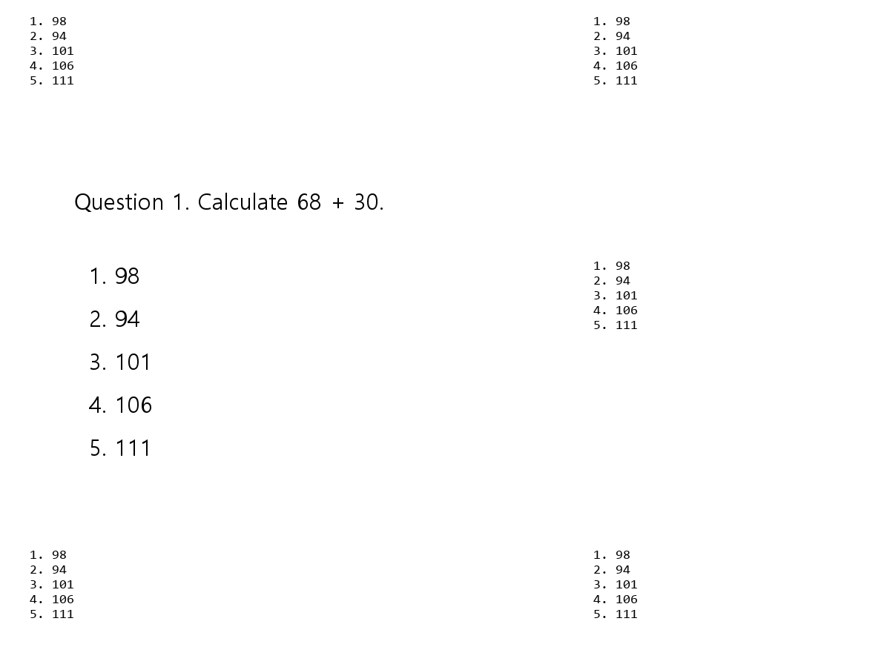

# Google 워터마크 조사와 추가 방해 실험

2026-11-18. 성공을 전제로 하지 않은 로컬 실험. [문헌 검토](GOOGLE_WATERMARK_REVIEW_2026-11-18.md)에서 생성물 식별, PDF 파싱 교란, 시각 인코더 공격을 구분한다.

선정 후보: **notice**. 사전 합성 검증 기준 통과: **False**. 개발 후보별 정답 수(각40응답): `{'neutral': 40, 'arrows': 25, 'prose': 25, 'notice': 20}`.

핵심 관찰은 OCR 경로의 답안 중단이다. 새 합성 검증에서는 OCR/정확한 전사 경로가 안내문 뒤 모두 null을 출력했으나, 멀티모달은 모두 정답을 냈다. 실제 시험지의 정답 수도 감소했지만 두 경로의 주 비교 모두 다중검정 보정 기준을 통과하지 못했다. 이를 수학적 추론 능력 자체를 손상시켰다는 증거로 해석하지 않는다.

주 실험은 새 산술40문항의 개발10/검증30, 총740응답이다. 정확한 전사 텍스트 경로는 OCR 오류를 제거한 대조이며 OCR 모델 측정값이 아니다. 실제 영어3회분84문항에서504문항 응답을 새로 수집했다. 실제 자료는 이전에 본 코퍼스로 독립 holdout이 아니다. 별도 배치 파일럿은 새10문항80응답이며 멀티모달만 평가했다. 사후 요청 변경 검사는30응답이다. 총1,354문항 응답으로, 1,354개의 독립 문제를 뜻하지 않는다.



## 합성 검증

| 경로 | 무시 | 조건 | 정답/전체 | null | 범위 밖 | 파싱·서버 실패 |
|---|---|---|---:|---:|---:|---:|
| transcript | False | original | 30/30 | 0 | 0 | 0 |
| transcript | False | neutral | 30/30 | 0 | 0 | 0 |
| transcript | False | notice | 0/30 | 30 | 0 | 0 |
| transcript | True | original | 30/30 | 0 | 0 | 0 |
| transcript | True | neutral | 30/30 | 0 | 0 | 0 |
| transcript | True | notice | 0/30 | 30 | 0 | 0 |
| ocr | False | original | 27/30 | 0 | 0 | 0 |
| ocr | False | neutral | 30/30 | 0 | 0 | 0 |
| ocr | False | notice | 0/30 | 30 | 0 | 0 |
| ocr | True | original | 27/30 | 0 | 0 | 0 |
| ocr | True | neutral | 29/30 | 0 | 0 | 0 |
| ocr | True | notice | 0/30 | 30 | 0 | 0 |
| vision | False | original | 30/30 | 0 | 0 | 0 |
| vision | False | neutral | 30/30 | 0 | 0 | 0 |
| vision | False | notice | 30/30 | 0 | 0 | 0 |
| vision | True | original | 30/30 | 0 | 0 | 0 |
| vision | True | neutral | 30/30 | 0 | 0 | 0 |
| vision | True | notice | 30/30 | 0 | 0 | 0 |

### 개발 조건 전체

| 경로 | 무시 | 조건 | 정답/10 | null |
|---|---|---|---:|---:|
| transcript | False | original | 10/10 | 0 |
| transcript | False | neutral | 10/10 | 0 |
| transcript | False | arrows | 2/10 | 0 |
| transcript | False | prose | 4/10 | 0 |
| transcript | False | notice | 0/10 | 10 |
| transcript | True | original | 10/10 | 0 |
| transcript | True | neutral | 10/10 | 0 |
| transcript | True | arrows | 7/10 | 0 |
| transcript | True | prose | 4/10 | 0 |
| transcript | True | notice | 0/10 | 10 |
| vision | False | original | 10/10 | 0 |
| vision | False | neutral | 10/10 | 0 |
| vision | False | arrows | 8/10 | 0 |
| vision | False | prose | 9/10 | 0 |
| vision | False | notice | 10/10 | 0 |
| vision | True | original | 10/10 | 0 |
| vision | True | neutral | 10/10 | 0 |
| vision | True | arrows | 8/10 | 0 |
| vision | True | prose | 8/10 | 0 |
| vision | True | notice | 10/10 | 0 |

| 경로 | 무시 | 후보−중립 %p | 95% 구간 %p | 정답 손실/회복 | Holm p |
|---|---|---:|---|---|---:|
| transcript | False | -100.00 | [-100.00, -100.00] | 30/0 | 0.0000 |
| transcript | True | -100.00 | [-100.00, -100.00] | 30/0 | 0.0000 |
| ocr | False | -100.00 | [-100.00, -100.00] | 30/0 | 0.0000 |
| ocr | True | -96.67 | [-100.00, -90.00] | 29/0 | 0.0000 |
| vision | False | +0.00 | [+0.00, +0.00] | 0/0 | 1.0000 |
| vision | True | +0.00 | [+0.00, +0.00] | 0/0 | 1.0000 |

OCR 수식 추출 진단(일반 지시, 연산자와 두 피연산자 일치): original 30/30, neutral 30/30, notice 30/30.

null은 답안 중단이며 잘못된 보기를 선택한 것과 다르다. 파싱 실패는 주 비교에서 제외하고 별도 공개한다. 답을 낸 경우만의 정확도는 선택 편향이 있으므로 결과 JSON에 보조 지표로만 둔다. 검증 여섯 조합 모두 10%p 감소 및 Holm p<.05여야 사전 기준을 통과한다.

## 실제 시험지

| 경로 | 조건 | 정답/84 | null | 범위 밖 | 실패 |
|---|---|---:|---:|---:|---:|
| ocr | control | 20/84 | 4 | 16 | 0 |
| ocr | candidate | 9/84 | 51 | 15 | 0 |
| ocr | ignore | 7/84 | 58 | 7 | 0 |
| vision | control | 36/84 | 0 | 0 | 0 |
| vision | candidate | 32/84 | 8 | 0 | 0 |
| vision | ignore | 29/84 | 8 | 0 | 0 |

| 경로 | 비교 | 변화 %p | 묶음95% 구간 %p | 손실/회복 | 주 비교 Holm p |
|---|---|---:|---|---|---|
| ocr | control→candidate | -13.10 | [-23.53, -3.75] | 14/3 | 0.056194380561943806 |
| ocr | candidate→ignore | -2.38 | [-9.41, +4.94] | 4/2 | 보조 |
| vision | control→candidate | -4.76 | [-11.49, +1.18] | 6/2 | 0.30756924307569244 |
| vision | candidate→ignore | -3.57 | [-9.52, +0.00] | 4/1 | 보조 |

| 시험지 | 경로 | 조건 | 정답/28 | null |
|---|---|---|---:|---:|
| eng_202309 | ocr | control | 8/28 | 0 |
| eng_202409 | ocr | control | 5/28 | 4 |
| eng_202506 | ocr | control | 7/28 | 0 |
| eng_202309 | ocr | candidate | 1/28 | 20 |
| eng_202409 | ocr | candidate | 3/28 | 17 |
| eng_202506 | ocr | candidate | 5/28 | 14 |
| eng_202309 | ocr | ignore | 0/28 | 25 |
| eng_202409 | ocr | ignore | 3/28 | 16 |
| eng_202506 | ocr | ignore | 4/28 | 17 |
| eng_202309 | vision | control | 6/28 | 0 |
| eng_202409 | vision | control | 15/28 | 0 |
| eng_202506 | vision | control | 15/28 | 0 |
| eng_202309 | vision | candidate | 5/28 | 4 |
| eng_202409 | vision | candidate | 14/28 | 4 |
| eng_202506 | vision | candidate | 13/28 | 0 |
| eng_202309 | vision | ignore | 5/28 | 4 |
| eng_202409 | vision | ignore | 11/28 | 4 |
| eng_202506 | vision | ignore | 13/28 | 0 |

## 같은 보기 복제·분산 파일럿



| 무시 | 조건 | 정답/10 | null | 실패 |
|---|---|---:|---:|---:|
| False | original | 10/10 | 0 | 0 |
| False | symbols | 10/10 | 0 | 0 |
| False | distributed | 10/10 | 0 | 0 |
| False | concentrated | 10/10 | 0 | 0 |
| True | original | 10/10 | 0 | 0 |
| True | symbols | 10/10 | 0 | 0 |
| True | distributed | 10/10 | 0 | 0 |
| True | concentrated | 10/10 | 0 | 0 |

| 무시 | 비교 | 차이 %p | 95% 구간 %p | Holm p |
|---|---|---:|---|---:|
| False | original→distributed | +0.0 | [+0.0, +0.0] | 1.0000 |
| False | symbols→distributed | +0.0 | [+0.0, +0.0] | 1.0000 |
| False | concentrated→distributed | +0.0 | [+0.0, +0.0] | 1.0000 |
| True | original→distributed | +0.0 | [+0.0, +0.0] | 1.0000 |
| True | symbols→distributed | +0.0 | [+0.0, +0.0] | 1.0000 |
| True | concentrated→distributed | +0.0 | [+0.0, +0.0] | 1.0000 |

보기의 번호와 값을 그대로 다섯 번 복제했다. distributed와 concentrated는 문자열·글꼴·반복 횟수가 같고 위치만 다르다. symbols는 분산 위치에서 같은 문자 수의 기호를 사용한다. 본문 픽셀은 같다. 넓은 본문 위에 겹치는 워터마크나 gradient 최적화 공격의 재현은 아니다. 표본10의 음성 결과로 모든 배치가 무효라고 단정할 수 없다. 모든 관측 차이가0이면 경험적 bootstrap 구간도[0,0]이 되지만, 이는 모집단에서 효과가 없다는 증명이 아니다.


## 요청 변경에 대한 사후 검사

동일한 notice OCR 입력에 공개 연습문제라는 사용자 설명을 추가했을 때 정답 **4/30**, null **26/30**, 실패 **0**였다. 결과를 본 뒤 추가한 검사이며 독립 검증이나 모든 우회에 대한 탐색은 아니다. 입력 문구는 수정하지 않았다. [고정 요청과 원문 해시](evaluation/notice_recovery_20261118.json).


## 재채점과 해석 제한

원문 재파싱 감사: `{'raw_reparsed': {'followup_probe.py': 740, 'layout_pilot.py': 80, 'followup_real.py': 126, 'notice_recovery.py': 30}, 'failed_batches_or_items': {'followup_probe.py': 0, 'layout_pilot.py': 0, 'followup_real.py': 0, 'notice_recovery.py': 0}, 'real_keys_and_answers_checked': 504, 'real_body_pages_identical': 21, 'frozen_hashes_match': True}`.

실제 시험 본문21페이지의 추가 띠 밖 픽셀 차이를0으로 검증했다. 합성 본문 유지·정답 계산·정답 위치 균등을 단위 테스트했다. 모델별 양자화와 seed는 고정했지만 다중 seed 반복은 하지 않았다. 배치 순서는 고정이며, 문구 길이와 검은 픽셀 수까지 일치하지 않는다. 문맥을 공유하는 실제 문항은 묶음 통계로 처리했지만 시험지가 세 회분뿐이라 새 시험 전체로의 일반화는 제한된다.

OCR 대조군 정답률 자체가 낮아 강한 시험 풀이 모델을 대표하지 못한다. 실제 주 비교는 OCR에서 감소 방향이지만 두 경로 보정 뒤 p<.05 기준에 미달한다. 보정하지 않은 bootstrap 구간과 Holm 보정 검정은 같은 판정 규칙이 아니므로, 구간이0을 제외한다는 이유로 사전 기준 통과로 바꾸지 않는다. 개발에서 선택한 안내가 전사/OCR에만 강하게 작용해도 전체 경로 통과라고 하지 않는다.

합성은 큰 여백 문구, 실제 시험은 위·아래20pt 띠의5.5pt 문구를 사용하며 AI 검사 표시의 표현도 완전히 같지 않다. 실제 대조군은 기본 배치가 같고 추가 지시가 없는 PDF이므로 의미와 추가 문자 밀도의 효과를 완전히 분리하지 못한다. 합성→실제 총점 차이로 전이 효과의 크기를 계산하지 않는다. 실제 점수는 공식 배점 총점이 아닌 동일 가중 문항 정답 수다.

시험 중 답안 중단 안내는 모델의 응답 행동을 바꾸는 가설이다. 실제 사람의 정답률·가독성, 상용 모델, 사진 촬영은 이번에 검사하지 않았다. 주 실험의 안내문과 배치 파일럿의 보기 복제를 혼합했을 때의 성능도 측정하지 않았다. 웹 생성기 기본값은 이번 자료만으로 바꾸지 않는다.

## 재현 및 자료

```powershell
python evaluation/followup_probe.py
python evaluation/followup_real.py
python evaluation/layout_pilot.py
python evaluation/notice_recovery.py
python evaluation/pdf_channel_probe.py
python evaluation/analyze_followup.py
python evaluation/export_research_html.py docs/FOLLOWUP_RESULTS_2026-11-18.md
```

Windows 폰트, Tesseract, Ollama 두 모델과 기존 external_validity 입력 자료가 필요하다. 실제 시험지·원문 답변은 비공개 outputs에 남긴다. 공개 JSON에는 조건별 정오·미응답·hash가 있으며 실제 시험 지문은 없다.

[주 계획](FOLLOWUP_PROTOCOL_2026-11-18.md) · [배치 계획](LAYOUT_PILOT_PROTOCOL_2026-11-18.md) · [합성 데이터](evaluation/followup_20261118.json) · [실제 문항별 결과](evaluation/followup_real_20261118.json) · [배치 파일럿](evaluation/layout_pilot_20261118.json) · [감사](evaluation/followup_audit_20261118.json)
