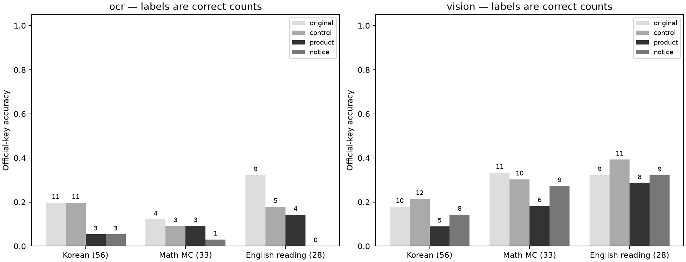

# 공개 수능 벤치마크: 원본과 우리 시험지 비교

2026-11-18. 2026학년도 수능 홀수형(2025-11-13 시행)을 기존 로컬 두 모델로 새로 풀게 한 결과다.

## 원본과 현재 제품

| 경로 | 원본 정답/117 | 제품 정답/117 | 정답률 변화 | 원본/제품의 6번 응답 |
|---|---:|---:|---:|---:|
| ocr | 24 | 10 | -11.97%p | 0/49 |
| vision | 30 | 19 | -9.40%p | 0/0 |

아래 선택과목별 표가 실제 배점 비교다. 117문항 합계는 모든 선택과목을 합친 연구용 정답 수이며 한 수험생의 응시 조합이 아니다. 원본 성능이 낮은 7B 모델이므로, 감소가 있더라도 고성능 상용 AI에 대한 효과로 일반화할 수 없다. 균등한 5지선다 무작위 선택의 기대 정답률은20%다. 범위 밖 숫자는 요청한 보기 번호로 해석할 수 없으므로 그대로 비정답 처리하며, 정답 계산값을 임의로 보기 번호로 변환하지 않았다.

배치 대조군→제품의 ocr 정답률 변화는 -7.69%p, 19개 공유 문맥 묶음의 95% 구간은 [-15.18, +3.28]%p, 두 주 비교에 대한 Holm p=0.3365다.
배치 대조군→제품의 vision 정답률 변화는 -11.97%p, 19개 공유 문맥 묶음의 95% 구간은 [-20.56, -6.15]%p, 두 주 비교에 대한 Holm p=0.0332다.

이는 한 회차·한 seed·두 로컬 모델·고정 입력 방식에서 관측한 결과다. 서로 다른 과목의 문맥 묶음을 합친 불확실성 추정이며, 새 시험 회차나 새 모델에서의 재현성을 보장하지 않는다. 제품과 notice의 숫자를 혼합하거나 가장 낮은 조건만 골라 제품 성능으로 부르지 않는다.

[KSAT AI Benchmark](https://github.com/roboco-io/KSAT-AI-Benchmark)의 공개 문항·공식 배점을 사용했다. upstream commit: `036bff7dfa263bee08693a627a4871107585229b`. 원 자료 라이선스는 CC BY-NC 4.0이며, 원본 시험지는 재배포하지 않는다. upstream 코드를 복제하지 않고 독립 평가기를 작성했다.

전체147개 중 영어 듣기17, 수학 단답형13을 제외한117개 고유 객관식 문항 전부를 평가했다. 국어56/수학33/영어28이며 공통 문항은 전체 집계에서 한 번만 센다. 같은 모델·요청·문항의 네 조건을 비교한936문항 응답이다. 통계적 독립 표본936개라는 뜻은 아니다.

- original: 원본 홀수형.
- control: QR 자리와 바깥 띠만 만든 배치 대조군.
- product: 현재 웹 생성기의 기본 워터마크·문항 QR·지문 프레임 처리.
- notice: 배치 대조군에 답안 중단 안내만 넣은 별도 실험용 후보. 제품 기본값이 아니다.



## 공식 정답 기준

| 모델 경로 | 과목 | 조건 | 정답/문항 | 배점 점수/평가 만점 | null | 범위 밖 | 실패 |
|---|---|---|---:|---:|---:|---:|---:|
| ocr | all | original | 24/117 | 58/291 | 15 | 13 | 0 |
| ocr | korean | original | 11/56 | 25/124 | 7 | 5 | 0 |
| ocr | math | original | 4/33 | 12/104 | 6 | 8 | 0 |
| ocr | english | original | 9/28 | 21/63 | 2 | 0 | 0 |
| ocr | all | control | 19/117 | 44/291 | 17 | 11 | 0 |
| ocr | korean | control | 11/56 | 24/124 | 5 | 5 | 0 |
| ocr | math | control | 3/33 | 9/104 | 5 | 4 | 0 |
| ocr | english | control | 5/28 | 11/63 | 7 | 2 | 0 |
| ocr | all | product | 10/117 | 24/291 | 8 | 55 | 0 |
| ocr | korean | product | 3/56 | 7/124 | 2 | 38 | 0 |
| ocr | math | product | 3/33 | 8/104 | 3 | 7 | 0 |
| ocr | english | product | 4/28 | 9/63 | 3 | 10 | 0 |
| ocr | all | notice | 4/117 | 8/291 | 94 | 1 | 0 |
| ocr | korean | notice | 3/56 | 6/124 | 38 | 1 | 0 |
| ocr | math | notice | 1/33 | 2/104 | 32 | 0 | 0 |
| ocr | english | notice | 0/28 | 0/63 | 24 | 0 | 0 |
| vision | all | original | 30/117 | 79/291 | 0 | 0 | 0 |
| vision | korean | original | 10/56 | 24/124 | 0 | 0 | 0 |
| vision | math | original | 11/33 | 34/104 | 0 | 0 | 0 |
| vision | english | original | 9/28 | 21/63 | 0 | 0 | 0 |
| vision | all | control | 33/117 | 80/291 | 0 | 0 | 0 |
| vision | korean | control | 12/56 | 26/124 | 0 | 0 | 0 |
| vision | math | control | 10/33 | 30/104 | 0 | 0 | 0 |
| vision | english | control | 11/28 | 24/63 | 0 | 0 | 0 |
| vision | all | product | 19/117 | 45/291 | 2 | 1 | 0 |
| vision | korean | product | 5/56 | 10/124 | 2 | 0 | 0 |
| vision | math | product | 6/33 | 17/104 | 0 | 1 | 0 |
| vision | english | product | 8/28 | 18/63 | 0 | 0 | 0 |
| vision | all | notice | 26/117 | 64/291 | 0 | 0 | 0 |
| vision | korean | notice | 8/56 | 18/124 | 0 | 0 | 0 |
| vision | math | notice | 9/33 | 26/104 | 0 | 0 | 0 |
| vision | english | notice | 9/28 | 20/63 | 0 | 0 | 0 |

전체291점은 모든 선택과목의 고유 문항을 합친 연구용 분모다. 실제 수험자의 한 시험 총점으로 해석하지 않는다. null·범위 밖은 비정답, 실행·형식 실패는 별도 공개하며 통계의 complete-case 쌍에서는 제외한다.

## 선택과목별 점수

| 경로 | 선택 조합 | 조건 | 정답/문항 | 공식 배점 점수/평가 만점 |
|---|---|---|---:|---:|
| ocr | 2026학년도 국어 · 화법과 작문 | original | 10/45 | 22/100 |
| ocr | 2026학년도 국어 · 언어와 매체 | original | 8/45 | 19/100 |
| ocr | 2026학년도 수학 · 확률과 통계 | original | 3/21 | 10/68 |
| ocr | 2026학년도 수학 · 미적분 | original | 1/21 | 4/68 |
| ocr | 2026학년도 수학 · 기하 | original | 2/21 | 6/68 |
| ocr | 2026학년도 영어 | original | 9/28 | 21/63 |
| ocr | 2026학년도 국어 · 화법과 작문 | control | 10/45 | 22/100 |
| ocr | 2026학년도 국어 · 언어와 매체 | control | 8/45 | 18/100 |
| ocr | 2026학년도 수학 · 확률과 통계 | control | 3/21 | 9/68 |
| ocr | 2026학년도 수학 · 미적분 | control | 2/21 | 6/68 |
| ocr | 2026학년도 수학 · 기하 | control | 2/21 | 6/68 |
| ocr | 2026학년도 영어 | control | 5/28 | 11/63 |
| ocr | 2026학년도 국어 · 화법과 작문 | product | 1/45 | 2/100 |
| ocr | 2026학년도 국어 · 언어와 매체 | product | 3/45 | 7/100 |
| ocr | 2026학년도 수학 · 확률과 통계 | product | 2/21 | 5/68 |
| ocr | 2026학년도 수학 · 미적분 | product | 2/21 | 5/68 |
| ocr | 2026학년도 수학 · 기하 | product | 3/21 | 8/68 |
| ocr | 2026학년도 영어 | product | 4/28 | 9/63 |
| ocr | 2026학년도 국어 · 화법과 작문 | notice | 2/45 | 4/100 |
| ocr | 2026학년도 국어 · 언어와 매체 | notice | 3/45 | 6/100 |
| ocr | 2026학년도 수학 · 확률과 통계 | notice | 0/21 | 0/68 |
| ocr | 2026학년도 수학 · 미적분 | notice | 0/21 | 0/68 |
| ocr | 2026학년도 수학 · 기하 | notice | 1/21 | 2/68 |
| ocr | 2026학년도 영어 | notice | 0/28 | 0/63 |
| vision | 2026학년도 국어 · 화법과 작문 | original | 8/45 | 20/100 |
| vision | 2026학년도 국어 · 언어와 매체 | original | 10/45 | 24/100 |
| vision | 2026학년도 수학 · 확률과 통계 | original | 7/21 | 21/68 |
| vision | 2026학년도 수학 · 미적분 | original | 5/21 | 17/68 |
| vision | 2026학년도 수학 · 기하 | original | 5/21 | 16/68 |
| vision | 2026학년도 영어 | original | 9/28 | 21/63 |
| vision | 2026학년도 국어 · 화법과 작문 | control | 12/45 | 26/100 |
| vision | 2026학년도 국어 · 언어와 매체 | control | 7/45 | 15/100 |
| vision | 2026학년도 수학 · 확률과 통계 | control | 7/21 | 22/68 |
| vision | 2026학년도 수학 · 미적분 | control | 5/21 | 17/68 |
| vision | 2026학년도 수학 · 기하 | control | 6/21 | 19/68 |
| vision | 2026학년도 영어 | control | 11/28 | 24/63 |
| vision | 2026학년도 국어 · 화법과 작문 | product | 5/45 | 10/100 |
| vision | 2026학년도 국어 · 언어와 매체 | product | 4/45 | 8/100 |
| vision | 2026학년도 수학 · 확률과 통계 | product | 4/21 | 12/68 |
| vision | 2026학년도 수학 · 미적분 | product | 3/21 | 9/68 |
| vision | 2026학년도 수학 · 기하 | product | 3/21 | 8/68 |
| vision | 2026학년도 영어 | product | 8/28 | 18/63 |
| vision | 2026학년도 국어 · 화법과 작문 | notice | 8/45 | 18/100 |
| vision | 2026학년도 국어 · 언어와 매체 | notice | 4/45 | 9/100 |
| vision | 2026학년도 수학 · 확률과 통계 | notice | 7/21 | 21/68 |
| vision | 2026학년도 수학 · 미적분 | notice | 4/21 | 13/68 |
| vision | 2026학년도 수학 · 기하 | notice | 4/21 | 12/68 |
| vision | 2026학년도 영어 | notice | 9/28 | 20/63 |

국어는45문항100점, 수학은객관식21문항68점, 영어는독해28문항63점이다. 제외 문항을0점으로 넣거나100점으로 환산하지 않았다. 선택 조합별 표에는 공통 문항이 반복되므로 표의 행들을 합산하면 안 된다.

## 짝지은 비교

| 경로 | 비교 | 정답률 변화 %p | 문맥 묶음95% 구간 %p | 손실/회복 | 주 비교 Holm p |
|---|---|---:|---|---|---|
| ocr | original→product | -11.97 | [-18.52, +0.00] | 21/7 | 보조 |
| ocr | control→product | -7.69 | [-15.18, +3.28] | 15/6 | 0.3364663533646635 |
| ocr | control→notice | -12.82 | [-17.55, -4.23] | 18/3 | 보조 |
| vision | original→product | -9.40 | [-16.83, -3.53] | 19/8 | 보조 |
| vision | control→product | -11.97 | [-20.56, -6.15] | 17/3 | 0.0331966803319668 |
| vision | control→notice | -5.98 | [-9.52, +0.00] | 10/3 | 보조 |

## 벤치마크 채점 정책 민감도

공식 정답표에서 영어37은⑤다. upstream 운영 정책은④도 추가 인정한다. 이는 공식 복수정답 변경이 아니다. 두 정책을 섞지 않고 영어 점수를 나란히 공개한다.

| 경로 | 조건 | 공식 점수/63 | upstream 추가 인정 점수/63 |
|---|---|---:|---:|
| ocr | original | 21/63 | 21/63 |
| ocr | control | 11/63 | 11/63 |
| ocr | product | 9/63 | 9/63 |
| ocr | notice | 0/63 | 0/63 |
| vision | original | 21/63 | 21/63 |
| vision | control | 24/63 | 24/63 |
| vision | product | 18/63 | 18/63 |
| vision | notice | 20/63 | 20/63 |

## 검증과 한계

원문/입력 감사: `{'raw_batches_reparsed': 336, 'failed_batches': 0, 'item_answers_checked': 936, 'pdf_key_entries_verified': 134, 'input_files_hashed': 336, 'frozen_hashes_match': True}`.

공식 PDF 정답표에서 번호·원형 숫자·배점을 별도 추출하여 객관식134문항의 메타데이터를 검증한 후 듣기17개를 제외했다. 국어·수학 선택과목의 반복 번호는 고유 ID로 분리했다. 정답표·배점·정답 메타데이터는 모델 입력에 넣지 않았다.

모델은 Qwen2.5 7B와 Qwen2.5-VL 7B다. OCR은 같은 렌더링에 Tesseract kor+eng PSM3을 적용했다. 수학 수식·도형은 이미지에 보존했지만 OCR 모델이 이를 정확하게 전사한다는 뜻은 아니다. 두 경로는 모델 자체도 다르므로 경로 간 차이를 OCR 하나의 인과 효과로 해석하지 않는다.

200dpi 렌더링 이미지이며 실제 카메라 촬영이 아니다. 로컬 문맥 길이 때문에 과목 전체 대신 페이지 묶음으로 평가했다. 국어·영어는 인접 페이지를 포함하고 공유 문맥의 연결 성분을 묶어 통계 처리했다. upstream 리더보드와 모델·프롬프트·입력 묶음·제외 문항이 다르므로 공식 리더보드 재현이나 상용 모델 성능이라고 부르지 않는다.

수식·도형 원본과 표시 영역 밖 픽셀을 보존했지만 선언된 프레임 안의 사람 가독성·부분 crop·상용 모델·다중seed는 검증하지 않았다. 한 회차의 자료이고 학습 오염이 완전히 없음을 보장하지 않는다. notice의 낮은 점수를 product의 성능으로 바꿔 쓰지 않는다.

## 재현

upstream 저장소를 outputs/upstream_ksat에 해당 commit으로 준비한 뒤:

```powershell
python evaluation/ksat_paired.py
python evaluation/ksat_analyze.py
python evaluation/export_research_html.py docs/KSAT_RESULTS_2026-11-18.md
```

[실험 계획](KSAT_PROTOCOL_2026-11-18.md) · [문항별 결과·설정·해시](evaluation/ksat_paired_20261118.json)

## 실행 기록

입력 준비 후 첫 모델 호출 전에 파일 경로 결합 오타로 중단되어 수정 후 `--infer-only`로 재개했다. 당시 모델 응답은 없었으며 문항·조건·채점 계획은 변경하지 않았다. 이후 고정 코드와 입력 해시를 검사했다. 모델의 짧은 풀이·최종 번호 형식을 동일하게 유지했으며, 긴 추론을 사용하는 상용 모델의 능력으로 일반화하지 않는다.

추가 표시 영역 밖의 본문 픽셀 비교 84건에서 최대 차이는 모두 0이었다. 국어·수학 생성 이미지도 눈으로 점검했다. 이 검사는 표시 영역 내부의 가독성이나 사람의 시험 성적을 보장하지 않는다.

공개 결과 JSON에 포함한 문항 ID·공식정답·배점은 upstream CC BY-NC 4.0 메타데이터에서 파생한 필드다. 이 메타데이터의 이용 조건과 독립 작성한 평가 코드의 라이선스는 구분한다.
